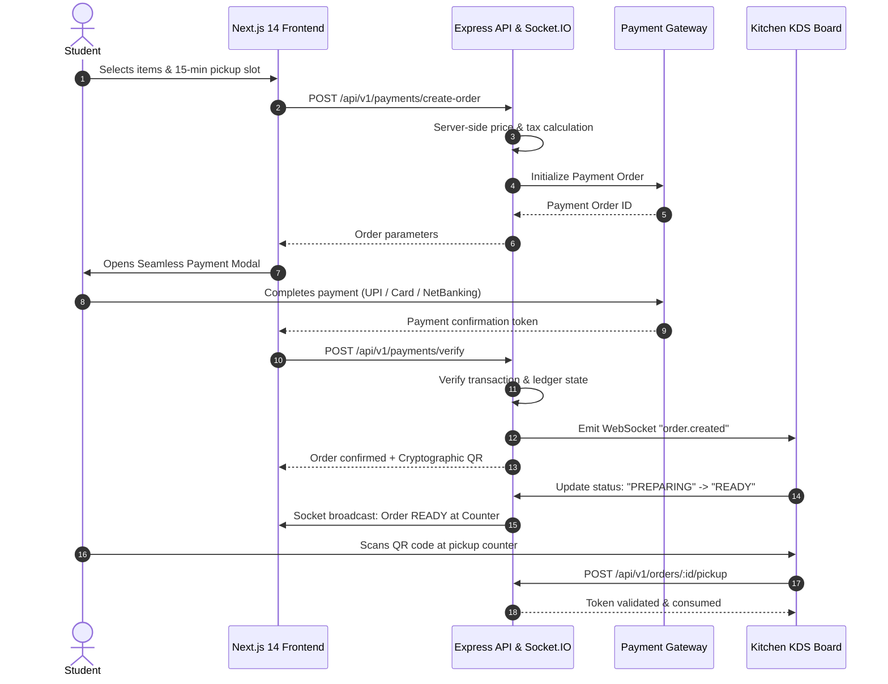

<div align="center">

# 🍱 CampusBite — India-Scale Campus Food Operating System

### *Tap. Order. Eat. Zero Waiting. Zero Food Waste.*

[](https://nextjs.org/)
[](https://nodejs.org/)
[](https://expressjs.com/)
[](https://fastapi.tiangolo.com/)
[](https://socket.io/)
[](https://www.prisma.io/)
[](https://www.npci.org.in/)
[](https://opensource.org/licenses/MIT)

<p align="center">
  <b>A comprehensive, high-throughput food operations ecosystem designed specifically for the Indian higher education sector.</b><br/>
  Solves the 15-minute recess bottleneck across universities with real-time slot scheduling, interactive 3D UI, tablet Kitchen Display Systems, AI-powered demand forecasting, and cryptographic QR order collection.
</p>

[Explore Features](#-the-problem--our-solution) •
[System Architecture](#-system-architecture) •
[User Personas & Workflows](#-five-specialized-portals--personas) •
[Quickstart Guide](#-quickstart--local-setup) •
[Demo Credentials](#-demo-accounts--credentials) •
[AI Engine](#-ai-intelligence-microservice) •
[REST API](#-rest-api-endpoints-overview)

---

</div>

## 📌 The Problem & Our Solution

### The Challenge
Across 40,000+ colleges in India, **millions of students and faculty rush to campus canteens during identical 10–15 minute break windows**:
1. **The Recess Crunch**: 45-minute queues force students to skip meals or arrive late to lectures.
2. **Paper Token & Cash Chaos**: Lost physical paper slips, manual calculation errors, and untracked cash transactions.
3. **Severe Food Waste**: Canteens cook blind without demand signals, resulting in 25–40% daily food spoilage or early stockouts.
4. **Zero Hygiene & Governance Transparency**: Colleges have no real-time oversight of food hygiene scores, vendor licenses, or student grievances.

### The CampusBite Solution
CampusBite digitizes the entire campus dining journey under an India-wide multi-tenant hierarchy:

$$\text{India} \longrightarrow \text{State} \longrightarrow \text{District} \longrightarrow \text{City} \longrightarrow \text{University} \longrightarrow \text{College} \longrightarrow \text{Campus} \longrightarrow \text{Canteen} \longrightarrow \text{Kitchen} \longrightarrow \text{Station} \longrightarrow \text{Pickup Counter}$$

- ⚡ **Express 15-Minute Slot Pre-Ordering**: Students order between lectures and select a designated pickup window (e.g., 12:15 PM – 12:30 PM). Food is freshly prepared just as they arrive.
- 📱 **Real-Time Live Order Tracker & Kitchen Display System (KDS)**: Socket.IO bi-directional WebSocket connection updates statuses instantly (`PAID` → `ACCEPTED` → `PREPARING` → `READY` → `PICKED_UP`).
- 🔐 **Cryptographic QR Anti-Fraud Pickup**: Digitally signed single-use QR tokens prevent duplicate food collections or stolen meals.
- 💳 **Authoritative Digital Checkout**: Server-side price calculation, promotional coupons, automatic 5% GST computation, and instant cashless confirmation.
- 🧠 **AI Food Intelligence & Owner Copilot**: Python FastAPI microservice providing demand forecasting, waste risk detection, dynamic queue ETA calculation, and conversational canteen intelligence.

---

## 🏛️ System Architecture

CampusBite is structured as a **modern high-performance monorepo** with separated concerns, shared database models, and independent scalability.

```
CampusBite (Monorepo)
├── apps/
│   ├── web/                     # Next.js 14 App Router Frontend
│   │   ├── src/app/             # Pages (Student Marketplace, Portals)
│   │   ├── src/components/      # 3D Canvas, KDS, Owner Dashboard, Modals
│   │   ├── src/store/           # Zustand reactive state store
│   │   └── tailwind.config.js   # Custom design tokens & theme
│   ├── api/                     # Node.js + Express + Socket.IO Backend
│   │   ├── src/routes/          # RESTful v1 API endpoints
│   │   ├── src/middleware/      # JWT auth, verification gates, error handler
│   │   ├── src/config/          # Environment configuration
│   │   └── test/                # Automated backend integration test suite
│   └── ai/                      # Python FastAPI Intelligence Microservice
│       ├── main.py              # ML Models (Demand, Dynamic ETA, Copilot)
│       └── requirements.txt     # Uvicorn, FastAPI, Pydantic
└── packages/
    └── database/                # Database abstraction layer
        └── prisma/
            ├── schema.prisma    # 30+ relational entity models
            ├── dev.db           # SQLite local database (Postgres-ready)
            └── seed.ts          # All-India college & canteen seed engine
```

### Data Flow Diagram



---

## 👥 Five Specialized Portals & Personas

CampusBite delivers role-tailored user interfaces designed for speed, clarity, and ergonomics on touchscreens and mobile devices:

| Portal | Intended Persona | Key Capabilities & Features |
| :--- | :--- | :--- |
| **Student Marketplace** | College Students & Faculty | • Interactive 3D Food Canvas hero<br/>• 12 Regional Indian cuisines (North, South, Street, Biryani, etc.)<br/>• Pan-India College directory with GPS map & custom college creator<br/>• 15-Minute pickup time slot selector<br/>• Real-time queue progress bar & single-use QR collection pass |
| **Canteen Command Center** | Canteen Owners & Vendors | • Real-time incoming order audio-visual ticker<br/>• Instant live price & stock toggle with Socket broadcast to browsing students<br/>• Raw inventory low-stock alerts & automated supplier reorder prompts<br/>• Daily GMV, average order prep duration, and revenue charts<br/>• **AI Canteen Copilot**: Natural language queries on margins & preparation batches |
| **Kitchen Display System (KDS)** | Head Chefs & Line Cooks | • High-contrast 3-column Kanban interface (`NEW ORDERS` → `PREPARING` → `READY`)<br/>• Station assignment (Fryer, Tandoor, Beverage, Assembly)<br/>• One-tap status transition that immediately notifies students<br/>• Audio chime on incoming urgent orders |
| **College Admin Portal** | Dean / Campus Administration | • Vendor licensing & hygiene certification approval desk<br/>• FSSAI compliance auditing (target score 98/100)<br/>• Food grievance & student complaint resolution tracker<br/>• Campus-wide nutrition and festival event food scheduling |
| **Super Admin Control Tower** | Nationwide Platform Operators | • Geographic state-by-state tree view (MH, KA, DL, TN, UP, WB, etc.)<br/>• Pan-India GMV metrics, university adoption rates, and active vendor counts<br/>• Microservice health telemetry & platform audit logs |

---

## 🔑 Demo Accounts & Credentials

The database comes pre-seeded with full operational test accounts across all roles.

> **Default Password for all accounts:** `Demo@1234`

| Role | Email Address | Password | Portal Entry URL |
| :--- | :--- | :--- | :--- |
| **Student** | `student@campusbite.in` | `Demo@1234` | `http://localhost:3000` |
| **Canteen Owner** | `owner@campusbite.in` | `Demo@1234` | Toggle via **Owner Portal** in top navigation |
| **Kitchen Staff** | `kitchen@campusbite.in` | `Demo@1234` | Toggle via **KDS Portal** in top navigation |
| **College Admin** | `collegeadmin@campusbite.in` | `Demo@1234` | Toggle via **Admin Portal** in top navigation |
| **Super Admin** | `superadmin@campusbite.in` | `Demo@1234` | Toggle via **Control Tower** in top navigation |

---

## 🧠 AI Intelligence Microservice

The AI engine runs on **FastAPI (Python 3.9+)** on port `8008`, offering specialized micro-models:

- 📈 **Demand Forecasting (`/api/v1/ai/demand-forecast`)**:
  Predicts hourly order volume per canteen based on historical trends, college class schedules, day-of-week seasonality, and weather factors.
- ⏳ **Dynamic Queue ETA (`POST /api/v1/ai/predict-eta`)**:
  Calculates precision wait times using linear queuing theory:
  $$\text{ETA} = \max(\text{prepTimes}) + (\text{queueLength} \times 2.5\text{ mins}) + \text{stationCongestionDelay}$$
- ⚠️ **Waste Risk Prediction (`/api/v1/ai/waste-risk`)**:
  Detects perishables approaching end-of-shelf-life and generates automatic happy-hour discounts to achieve **Zero Campus Food Waste**.
- 💬 **Canteen Owner Copilot (`POST /api/v1/ai/copilot-query`)**:
  Provides natural language analytics on prep schedules, bestsellers, margin analysis, and inventory reordering.

---

## 💻 Quickstart & Local Setup

### Prerequisites
- **Node.js**: v18.0.0 or v20.x
- **npm**: v9.0+
- **Python**: v3.9+ (with `pip`)
- **Git**

---

### Step 1: Clone the Repository
```bash
git clone https://github.com/imsinghaditya07/CampusBite.git
cd CampusBite
```

---

### Step 2: Install Node Dependencies
```bash
npm install
```

---

### Step 3: Set Up Environment Variables
Create the backend environment file:
```bash
cp apps/api/.env.example apps/api/.env
```

*(Pre-configured with test defaults; works out-of-the-box for local testing.)*

---

### Step 4: Initialize & Seed the Database
```bash
# Push database schema to local SQLite database
npm run db:push

# Seed with 30+ Indian colleges, 12 regional categories, menus, and test personas
npm run db:seed
```

---

### Step 5: Start All Services

You can start each service individually across separate terminal windows:

#### Terminal 1 — Web Application (Next.js)
```bash
npm run dev:web
# Runs on http://localhost:3000
```

#### Terminal 2 — Backend API & Real-Time Engine (Express & Socket.IO)
```bash
npm run dev:api
# Runs on http://localhost:4000
```

#### Terminal 3 — AI Intelligence Engine (FastAPI)
```bash
# Optional: create a virtual environment first
cd apps/ai
pip install -r requirements.txt
python3 -m uvicorn main:app --reload --port 8008
```

---

### Step 6: Verify Health Status
Open your browser or run curl to verify all microservices are responding:

```bash
# Web Frontend
curl -I http://localhost:3000

# Backend API
curl http://localhost:4000/api/v1/canteens/campusbite-central-iitb

# Python AI Engine
curl http://localhost:8008/api/v1/ai/health
```

---

## 🧪 Running Automated Tests

CampusBite includes an end-to-end backend integration test verifying authentication, cart validation, order placement, and cryptographic token verification:

```bash
# Run test suite
npx tsx apps/api/test/backend.test.ts
```

---

## 🗺️ REST API Endpoints Overview

| Method | Endpoint | Description |
| :--- | :--- | :--- |
| `POST` | `/api/v1/auth/login` | Email/password login with JWT token issuance |
| `GET` | `/api/v1/colleges` | List onboarded colleges with canteen counts |
| `POST` | `/api/v1/colleges/custom` | Register custom college with real-time state sync |
| `GET` | `/api/v1/canteens/:id` | Full canteen profile, operational status & menu catalog |
| `PATCH` | `/api/v1/canteens/items/:id/price-availability` | Instant price update & 86/stockout toggle (emits socket event) |
| `POST` | `/api/v1/orders` | Place food order with time-slot reservation |
| `GET` | `/api/v1/orders/:id` | Live status, countdown timer & cryptographic QR token |
| `POST` | `/api/v1/payments/order` | Calculate itemized totals & create digital payment order |
| `POST` | `/api/v1/payments/verify` | Payment verification & KDS dispatch |
| `POST` | `/api/v1/payments/webhook` | Asynchronous payment webhook processing |
| `GET` | `/api/v1/kds/orders` | Active kitchen order stream for tablet KDS |
| `PATCH` | `/api/v1/kds/orders/:id/status` | Advance order state (`ACCEPTED` → `PREPARING` → `READY`) |
| `GET` | `/api/v1/inventory/:canteenId` | Raw ingredient stock levels & threshold alerts |
| `GET` | `/api/v1/admin/superadmin-control-tower` | Pan-India GMV, state-level performance & audit logs |

---

## 🏆 Hackathon Evaluation Highlights

| Judging Criteria | How CampusBite Delivers |
| :--- | :--- |
| **Real-World Impact** | Solves a daily pain point experienced by 40+ million students across Indian colleges with an express slot pre-order system. |
| **Technical Depth** | Full-stack monorepo featuring Next.js 14, 3D Canvas, Socket.IO WebSockets, Prisma relational modeling (30+ entities), and a Python AI engine. |
| **Financial Integrity** | Production-grade digital payment flow with server-side price calculation, coupon validation, and tamper-proof ledger. |
| **Design & UX** | High-contrast, tactile interface with smooth micro-interactions, responsive mobile/tablet KDS layouts, and instant live visual cues. |
| **Multi-Tenancy** | True hierarchical scaling from pan-India control towers down to individual kitchen station counters. |

---

## 📄 License & Attribution

This project is open-source under the [MIT License](LICENSE).

Developed with ❤️ for Indian campus dining innovation.
